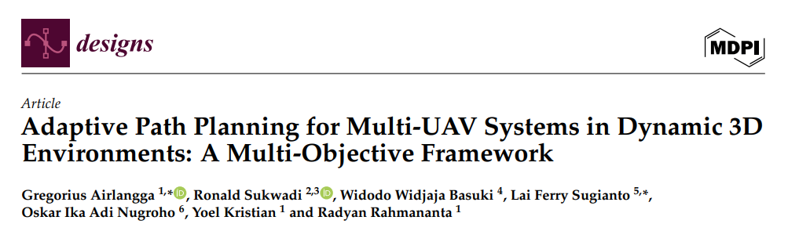
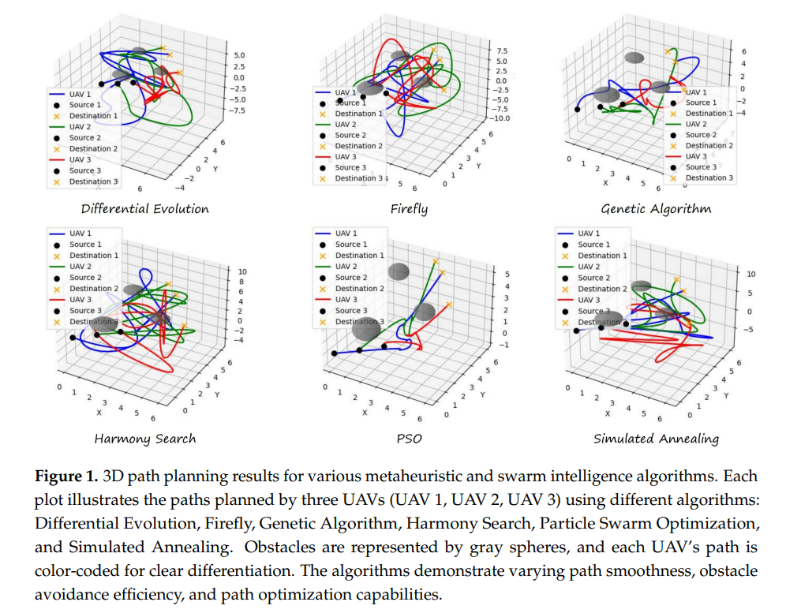
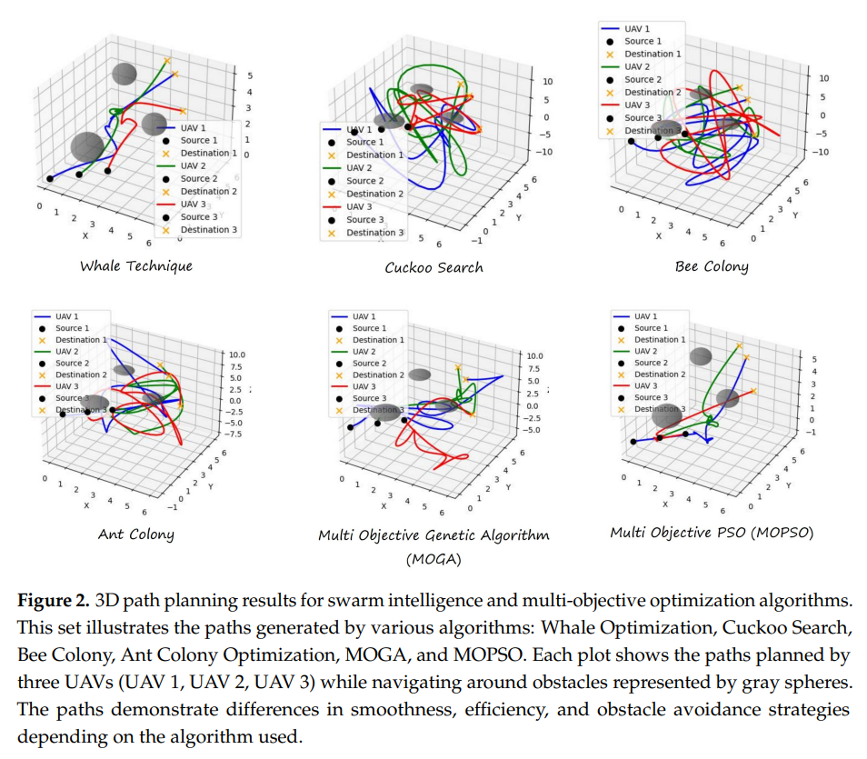
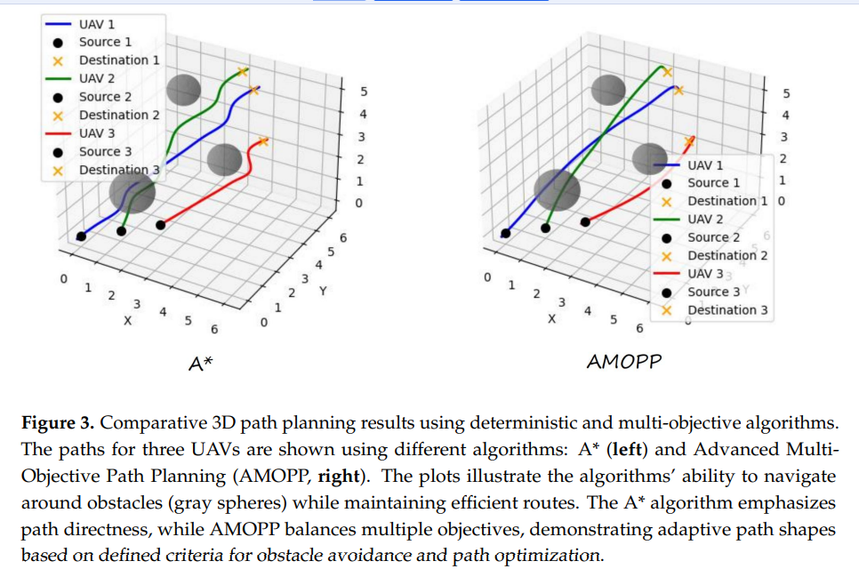
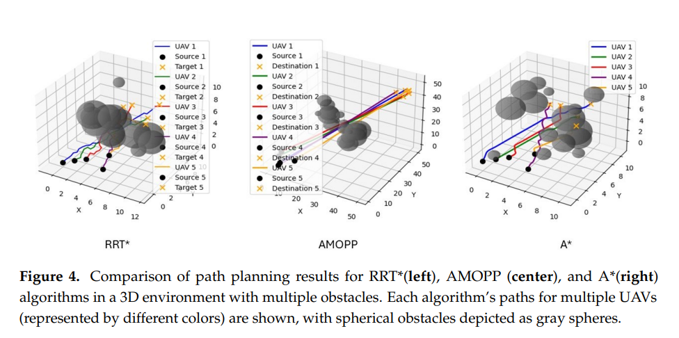
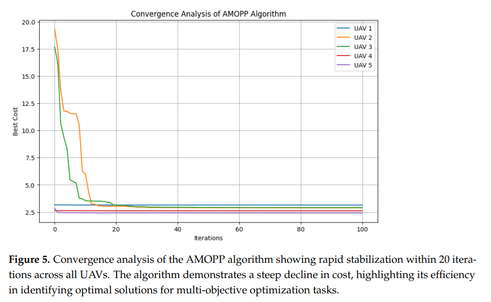
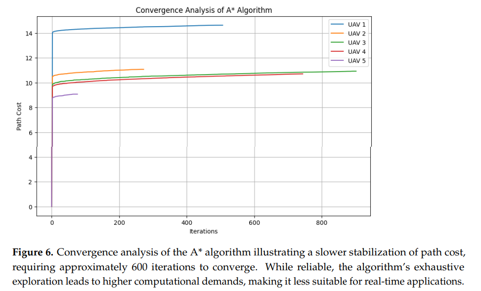
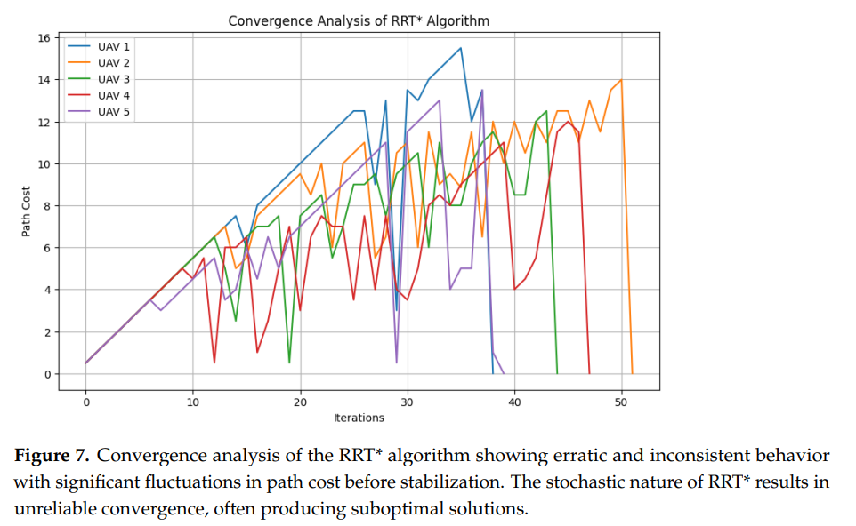

# [UAV Path Planning]Dynamic 3D Environment Multi-Drone Navigation New Breakthrough! AMOPP Framework for Multi-Objective Optimal UAV Path Planning[with Python Code]

Dynamic 3D environment with multiple UAV systems: an adaptive path planning framework for multi-objectives
Abstract: This paper evaluates and compares the computational performance and practical applicability of advanced path planning algorithms for unmanned aerial vehicles (UAVs) in dynamic and obstacle-dense environments. It focuses on proposing an Adaptive Multi-Objective Path Planning (AMOPP) framework that achieves balanced optimization of multiple objectives such as path length, smoothness, collision avoidance, and real-time responsiveness. Experiments demonstrate its superior performance: it reduces path length by 15% compared to the A algorithm, with an average distance of only 450m; it has an angle deviation of 8.0°, outperforming traditional methods like genetic algorithms and particle swarm optimization (PSO); it achieves a zero collision rate in full simulation, surpassing heuristic algorithms like the Hummingbird Search and Bee Swarm Optimization; and it has an average replanning time of 0.75s, significantly better than both A and RRT*. The time complexity of AMOPP is O(k·n), and its space complexity is O(n), making it scalable and efficient for large-scale tasks. This paper also conducts a comprehensive qualitative and quantitative comparison of 14 algorithms through 3D visualization, clearly identifying their strengths and weaknesses and their suitability for different scenarios. The framework integrates weighted optimization, penalty function strategies, and spline interpolation, providing a robust solution for UAV path planning, particularly suitable for scenarios requiring smooth navigation and adaptive replanning, making it an ideal framework for real-time, efficient, and safe operations in dynamic environments.
Introduction: UAVs have become essential tools in various industries such as military reconnaissance, logistics transportation, environmental monitoring, precision agriculture, and disaster relief. Their autonomous capabilities in complex and hazardous environments have revolutionized data collection, material delivery, and search and rescue tasks, achieving high efficiency and cost-effectiveness. However, as the application scenarios of UAVs expand, the challenges they face are becoming increasingly complex: not only must they navigate in dynamic environments with unpredictable obstacles and limited navigable space, but they also need to avoid collisions while achieving their individual mission goals. Therefore, developing path planning algorithms that can optimize navigation in realistic scenarios is key to unlocking the potential of UAV technology.
Traditional path planning algorithms, such as A* and Dijkstra's algorithm, have laid the foundation for drone navigation. They can find the shortest path in static, well-defined environments while ensuring optimality. However, their limitations become evident in dynamic, uncertain real-world scenarios. Heuristic optimization methods like particle swarm optimization and genetic algorithms can explore a wider solution space and handle non-deterministic factors, providing approximate optimal solutions in complex environments. However, they are computationally expensive and difficult to implement in real time.
Reinforcement learning, though it allows drones to learn optimal navigation strategies through interaction with the environment and achieve real-time adaptability, mostly focuses on single-objective optimization, failing to meet the multidimensional, even conflicting objective demands of actual drone tasks. The need for advanced multi-objective path planning in constrained environments such as urban areas, disaster zones, and mountainous regions highlights the importance of this—where drones must simultaneously avoid obstacles, fly smoothly, and optimize task efficiency. Moreover, time-sensitive scenarios like disaster preparedness demand high real-time adaptability, where delays or non-optimal paths could lead to mission failure or increased risk. Existing multi-objective optimization methods, while capable of balancing energy consumption, time, and obstacle avoidance, face high computational demands and are difficult to implement in real-time; reinforcement learning, despite its high training costs, vulnerability to environmental instability, limited scalability for multi-drone collaboration, and often overlooking direct relevance to drone stability, safety, and energy consumption in path smoothness design.
The current research gap lies in the lack of an efficient, real-time multi-objective path planning scheme suitable for multi-drone operations in complex dynamic environments. Most studies simplify the environmental conditions and existing models are low in computational efficiency, failing to meet real-time operational needs. There is also a lack of design for path smoothness that directly relates to drone stability, safety, and energy consumption. To address these issues, this paper develops the AMOPP framework, aiming to achieve effective balance among multiple objectives while ensuring real-time adaptability and computational efficiency. It validates its suitability, efficiency, and multi-objective optimization capabilities through simulation experiments that simulate real operational environments.
Method Introduction: The proposed AMOPP framework is specifically designed for multi-drone systems in complex dynamic 3D environments, focusing on four key parameters: minimizing path length, enhancing path smoothness, ensuring collision avoidance, and optimizing trajectory feasibility. It integrates heuristic optimization with real-time adaptive strategies to dynamically adjust drone paths, while also considering computational efficiency and the feasibility of complex scenarios. Its core design includes two parts: problem modeling and algorithm implementation.
1  
Multi-objective optimization problem modeling
The path planning of unmanned aerial vehicles (UAVs) is transformed into a continuous optimization problem, with the trajectory represented by a continuous curve in three-dimensional space. Mathematical models for each objective are constructed: Path length is minimized through integration; smoothness is quantified by integrating the rate of change of the UAV's angle direction to reduce trajectory discontinuities; obstacles are modeled as spheres, and a Heaviside step function is introduced to construct a penalty function that imposes infinite penalties on trajectories that collide with obstacles, forcing collision avoidance; The energy consumption model is defined based on the baseline power consumption of the UAV and additional power consumption due to movement, minimizing total energy consumption. A multi-objective optimization mathematical expression is ultimately established, and weighted aggregation is employed to assign weights (the sum of which equals 1) to each objective, transforming multi-objective optimization into a single scalar cost function minimization problem. Weights can be adjusted according to specific task requirements to adapt the priorities of objectives.
1  
AMOPP algorithm core process
The algorithm employs a continuous iterative optimization strategy to optimize the drone trajectory. In the initial phase, an initial path is generated by linear interpolation from the starting point to the endpoint, dividing the trajectory into multiple segments. Subsequently, random perturbations are applied to each intermediate segment point, generating candidate points and verifying whether they fall within the operational boundary or have entered restricted areas. If verified, a new path is generated; the cost of this new path is calculated by integrating the length of the path, collision avoidance penalty, and energy consumption cost function. If the new cost is lower, the optimal path is updated accordingly. Additionally, during each iteration, the positions of dynamic obstacles and moving targets are updated in a uniform distribution, enabling real-time adaptation to environmental changes.
1  
Key design highlights
The system adopts a decentralized architecture, where each drone independently calculates its trajectory based on the global constraints of the environment model. Only when potential trajectory conflicts occur will they share position data. This significantly reduces communication overhead and computational bottlenecks. The spline interpolation technique is introduced to refine the planned path into continuous and gradual curves, eliminating directional abrupt changes, thereby enhancing trajectory smoothness. By minimizing the squared integral of the drone's trajectory acceleration using least squares method, the system reduces body shake. The cost function imposes immediate penalties for collision behaviors and provides positive feedback for smoother trajectories, solving the sparse reward problem and ensuring clear feedback for every step of optimization.
Conclusion: This paper evaluates the performance of various drone path planning algorithms in dynamic dense obstacle environments by core metrics such as path length, smoothness, collision avoidance, real-time responsiveness, and computational complexity. It verifies the superiority of the AMOPP framework—a high-efficiency solution that balances multiple optimization objectives while maintaining low computational overhead. It is an excellent solution for multi-drone path planning in dynamic environments.
Experimental results show that AMOPP achieves an average path length of 450m with an angle deviation of only 8.0°, and its trajectory smoothness is on par with MOPSO and better than all other algorithms. Full simulation achieves a zero collision rate, highlighting the safety and reliability of navigation in complex obstacle environments. With an average replan time of 0.75s, it significantly shortens compared to A* (2.5s) and RRT* (1.8s), demonstrating strong real-time adaptability and is suitable for critical drone tasks such as urban logistics, disaster relief, and search and rescue requiring rapid path adjustments. Computational complexity analysis indicates that AMOPP has a time complexity of O(k·n) and space complexity of O(n), demonstrating good scalability and suitability for large-scale real-world applications.
In contrast, algorithms like A* and ant colony optimization are effective in static/partially dynamic scenarios but require higher computational demands and struggle to adapt to time-sensitive tasks. MOPSO and genetic algorithms perform competitively in single metrics but suffer from high computational costs and insufficient real-time responsiveness. Algorithms like firefly algorithm and bee colony optimization, which prioritize exploration, cannot achieve efficient, collision-free smooth path planning.
This study provides a robust solution for multi-UAV path planning in dynamic 3D environments. Future research will further integrate energy consumption models with real environmental uncertainties into the optimization framework to enhance the adaptability of AMOPP to actual UAV tasks. At the same time, it explores a hybrid approach combining heuristic algorithms and deterministic algorithms to further optimize path planning performance.

## Images

<!-- PAYMENT_BLOCK -->

## Get this dataset

- Payment link (Stripe): [Buy now](https://buy.stripe.com/3cs8yP7sY87d0vu9AB)
- Payment QR code: 

<!-- /PAYMENT_BLOCK -->
